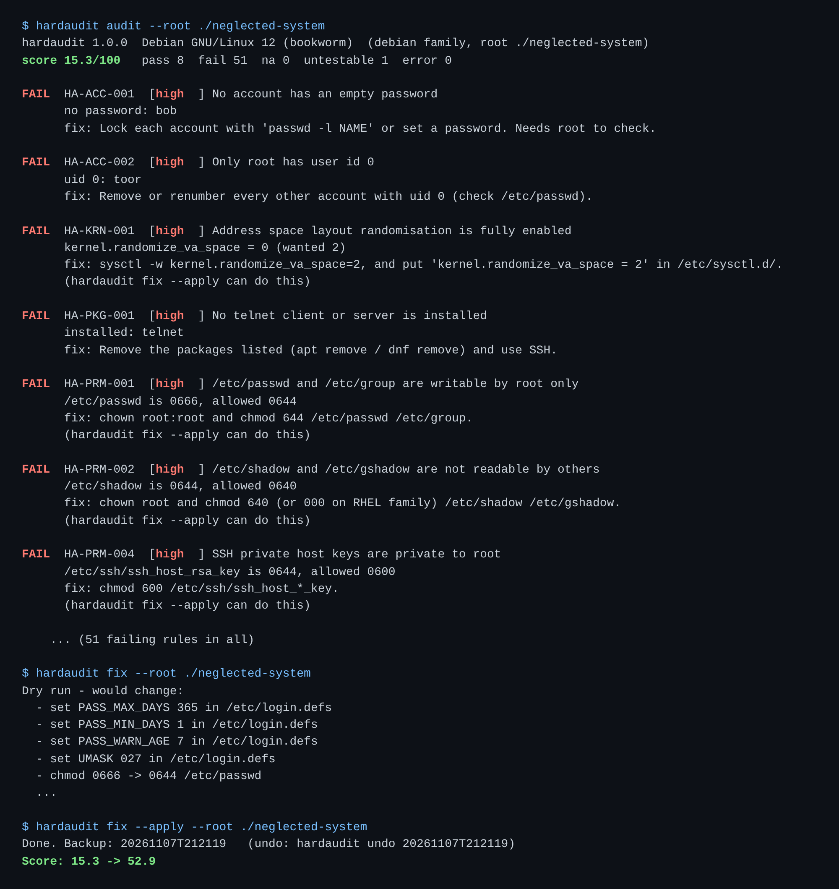

# hardaudit

[](https://github.com/TexAlphaWolf/sec-linux-hardening-audit/actions/workflows/ci.yml)
[](https://github.com/TexAlphaWolf/sec-linux-hardening-audit/actions/workflows/codeql.yml)


Checks a Linux machine (or the file system of an image) against **60 rules** in 8 areas: kernel settings, network settings, SSH, accounts and passwords, file permissions, file systems, installed software, logging. It prints what failed and why, scores the machine, and, for the **23 of them** that are safe to automate, can fix them with a backup and an undo.



*A made-up neglected Debian system (a test fixture). The score goes from 15.3 to 52.9 with the safe fixes alone; the rest needs a person's decision.*

Runs on **Debian/Ubuntu and the RHEL family** (Rocky, Alma, RHEL, Fedora). Standard library only, Python 3.11+. Rules are plain TOML files, so you can add your own.

## Use it

```bash
pip install .                      # or: pipx install .
sudo hardaudit                     # audit this machine (root reads /etc/shadow; without it some rules say "untestable")
sudo hardaudit audit -v            # also list what passed
hardaudit audit --format html -o report.html
sudo hardaudit fix                 # DRY RUN: shows exactly what it would change
sudo hardaudit fix --apply         # does it, keeps a backup, prints the score before and after
sudo hardaudit undo 20261107T212055
hardaudit rules                    # list the rules
```

`hardaudit audit` exits 1 if a rule of severity **high** or worse fails (`--fail-on medium|low|none` changes that), so it can gate a pipeline.

### Audit an image or another disk without running it

```bash
docker export "$(docker create debian:12)" | sudo tar -x -C tree
sudo hardaudit audit --root tree
# or with the container image of this project (nothing is installed on the host):
docker run --rm -v "$PWD/tree:/host:ro" hardaudit audit --root /host
```

With `--root`, there is no running kernel: kernel settings are read from the sysctl files, mounts from `/etc/fstab`, and whatever cannot be known that way is reported as **untestable**, never guessed (see [limitations](docs/limitations.md)).

## How the fixes are kept safe

- **Dry run is the default.** `fix` alone changes nothing and lists each change.
- **Only 23 rules have a fix**, and a fix can only remove permission bits, set one kernel value to a stricter one, change one named line, or block one module. SSH, firewall, mounts, packages and accounts are never changed: a wrong value there can lock you out. A test fails if a rule in those areas gets a fix.
- **Backup first.** Every file is copied before it is touched, into `/var/lib/hardaudit/backups/<id>/`, and the manifest is saved after each step, so a run interrupted halfway can still be undone.
- **`undo` restores byte for byte**, including file modes, and removes files and empty directories the fix created. It never removes a directory that has other files in it.
- A kernel setting that cannot be changed live (a container mounts `/proc/sys` read-only) is **a warning, not a failure**: the value is still saved in `/etc/sysctl.d/99-hardaudit.conf`.

## Measured

Every number comes from a script in this repository that CI re-runs. Details and the bugs these runs found: [docs/evaluation.md](docs/evaluation.md).

| What | Result |
|---|---|
| Each rule fails when its condition is broken on purpose (Debian-style and RHEL-style fixture trees) | 59 of 59 per family; the 60th is a service state, which needs a running system |
| Each automatic fix makes its own rule pass again | 23 of 23 per family |
| SSH settings as hardaudit reads them, against the real `sshd -T` (OpenSSH 9.6), 2,000 random configurations with duplicates, `Include`, `Match`, case and `=` | 22,000 values compared, **0 differences** |
| Real system round trip: audit, fix, audit, undo, compare all of `/etc` | Ubuntu 24.04 VM: 597 files, **0 differences**, score 67.5 to 82.5. Debian 12 container: 157 files, **0 differences**, 71.9 to 79.8. Rocky 9.3 container: 238 files, **0 differences**, 73.0 to 78.4 |
| Time for a full audit | about 4 ms on a fixture tree; 12 ms (Ubuntu), 4 ms (Debian), 39 ms (Rocky) on real systems |
| Tests | 260 (the 2 service-state tests skip on a directory tree; one more skips only as root), coverage above 90% (enforced), run as root and as an ordinary user |

**What is *not* measured yet:** the round trip on Debian 13 and Alma 9, and the offline audit of exported images. They are CI jobs ("real system", "exported image" in [the Actions tab](https://github.com/TexAlphaWolf/sec-linux-hardening-audit/actions)). The test suite and `tools/evaluate.py` also passed inside a Debian 13 container (Python 3.14). Ubuntu was measured on a VM, Debian and Rocky in containers, which share the host kernel and cannot change it: there, 3 kernel settings are refused live, reported as warnings, and still saved in the sysctl file.

## What it is not

Not a compliance tool: the rules follow the *topics* of common hardening guides, in this project's own words, and nothing is certified. It does not check PAM, firewall rules, auditd rules, SELinux/AppArmor, listening services or container/Kubernetes settings. It reads configuration, not behaviour: `PermitRootLogin no` in a file is what it checks, not whether `sshd` was reloaded. For a broader audit use OpenSCAP or Lynis; this project is a small, readable, testable one. More in [docs/limitations.md](docs/limitations.md).

## Docs

- [Rules](docs/rules.md): the table of all 60, and how to write your own
- [Evaluation](docs/evaluation.md): what was measured and what the tests found
- [Limitations](docs/limitations.md)
- [Security policy](SECURITY.md), [Contributing](CONTRIBUTING.md), [Changelog](CHANGELOG.md)

Reports contain host and user names; look before you share one.

## License

MIT, Luca Tessitore
